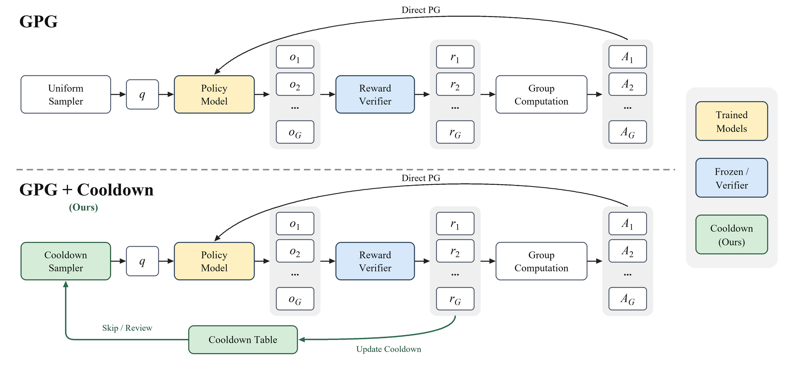

# GPG + Cooldown 團隊開發與訓練指南

本文件說明本分支相較於官方 [`AMAP-ML/GPG`](https://github.com/AMAP-ML/GPG) 的程式改動、Windows / RTX 4060 8GB 環境建置、訓練與對照實驗啟動方式，以及超參數調整細節。

---

## 1. 專案概述與核心改動



針對本地單卡 8GB VRAM 環境與動態題目抽樣機制，主要修改了 `open-r1/src/open_r1/` 底下的三個檔案並新增本地實驗腳本：

1. **`open-r1/src/open_r1/configs.py`**
   - 於 `GPGConfig` 新增 `cooldown_steps: int = 20`（某題在群組 rollouts 中全對後，冷卻多少個 `global_step` 才重新加入抽樣池複習）。
   - `sample_strategy` 的說明補齊支援選項：`hard`、`uniform`、`soft`、`medium`。

2. **`open-r1/src/open_r1/gpg_trainer.py`**
   - **逐 batch 動態抽樣與冷卻機制（`AdpativeRepeatRandomSampler`）**：從第 1 個 epoch 起即改為逐 batch 依 `global_step` 動態計算抽樣權重（`rng = random.Random(base_seed + global_step)`）。在 `compute_loss` / reward 記錄階段，若題目平均分數 `score >= 1.0`（該題 rollouts 全對），將 `next_eligible_step[p]` 設為 `current_step + cooldown_steps`；未全對則重設為 `0` 立即恢復抽樣。若所有題目皆處於冷卻或權重為 0，會自動退回均勻抽樣防止 `random.choices` 報錯。
   - **修正 `prompt` 型別判斷 bug**：`make_conversation` 產生的 `prompt` 為 `list[dict]`，原版誤判為 `(dict,)`，已修正為 `isinstance(..., (list,))`。
   - **改良 `weight_soft`（Safe-Soft）**：僅取最近 3 次紀錄（`rewards[-3:]`）計算滑動平均，且對全錯或低分題保留 `0.2` 保底權重（`max(0.2, 1.0 - mean)`），避免難題被永久封殺導致題型偏食。
   - **生成階段啟用 KV Cache**：於 `unwrapped_model.generate(...)` 期間暫時切換至 `.eval()` 並設定 `use_cache=True`，避免 `gradient_checkpointing` 鎖死 `use_cache=False` 造成 $O(L^2)$ 重複計算，生成結束後再透過 `finally` 還原狀態。
   - **Checkpoint 額外狀態保存**：儲存模型 checkpoint 時，同步寫出 `next_eligible_step.json`（與 `data_weight.json` 同層），方便檢查冷卻狀態或續訓。

3. **`open-r1/src/open_r1/rewards.py`**
   - **Windows `math_verify` Patch**：Windows 沒有 `signal.SIGALRM`，`math_verify` 預設每次 `parse`/`verify` 會 spawn 子進程導致 `WinError 6` 且驗算恆為 `0`。在非 POSIX 系統上自動將 `math_verify` 的 `timeout` 替換為 no-op，確保數學答案批改正常運作。

4. **新增實驗與輔助檔案**
   - `open-r1/recipes/local_rtx4060_gpg_cooldown.yaml`：單卡 RTX 4060 8GB LoRA + GPG Cooldown 設定檔。
   - `open-r1/scripts/compare_gpg_vs_cooldown.py`：一鍵跑完原版 GPG 與 Cooldown 改良版訓練，並在 Base / Train-200 / Eval-100 上做 Greedy Decoding 評測與產出報表。
   - `open-r1/scripts/generate_math_dataset.py`：確定性數學題庫生成器（10 大題型、嚴格零重疊，Train 200 題 + Eval 100 題），已預先生成並附在 `open-r1/datas/math_200/train.jsonl` 與 `open-r1/datas/eval_100.jsonl`。

---

## 2. 環境建置（Windows / RTX 4060 8GB 實測版本）

本機實際測試通過的套件版本如下（`openr1_venv/` 與 `models/` 已被 `.gitignore` 排除，clone 後需自行建立）：

- **Python**: `3.11.9`
- **PyTorch**: `2.5.1+cu124`
- **核心套件**:
  - `transformers==4.50.0`
  - `trl==0.16.0`
  - `peft==0.22.0`
  - `accelerate==1.4.0`
  - `datasets==3.6.0`
  - `math-verify==0.5.2`
  - `latex2sympy2_extended==1.0.6`
  - `huggingface_hub==0.36.2`
  - `safetensors==0.8.0`
  - `tensorboard==2.21.0`

> **注意（Windows 請勿執行 `pip install -e .`）**：`open-r1/setup.py` 綁定了僅支援 Linux 的 `deepspeed==0.15.4`、`liger_kernel==0.5.3`、`vllm==0.7.2` 與 `bitsandbytes`，在 Windows 上直接 `pip install -e .` 會失敗。請依下方指令手動安裝，並透過 `PYTHONPATH=src` 執行程式。

### Step 1：建立虛擬環境與安裝套件（PowerShell）

```powershell
cd open-r1
python -m venv openr1_venv
.\openr1_venv\Scripts\python.exe -m pip install --upgrade pip

# 安裝 CUDA 12.4 版 PyTorch
.\openr1_venv\Scripts\pip.exe install torch==2.5.1 --index-url https://download.pytorch.org/whl/cu124

# 安裝訓練與評測所需核心套件（不裝 deepspeed / vllm / liger_kernel）
.\openr1_venv\Scripts\pip.exe install `
  transformers==4.50.0 `
  trl==0.16.0 `
  peft==0.22.0 `
  accelerate==1.4.0 `
  datasets==3.6.0 `
  math-verify==0.5.2 `
  latex2sympy2_extended==1.0.6 `
  huggingface-hub==0.36.2 `
  safetensors==0.8.0 `
  tensorboard==2.21.0
```

### Step 2：下載基礎模型

`open-r1/recipes/local_rtx4060_gpg_cooldown.yaml` 預設讀取本地路徑 `models/Qwen2.5-0.5B-Instruct`，請先下載至該目錄：

```powershell
.\openr1_venv\Scripts\huggingface-cli.exe download Qwen/Qwen2.5-0.5B-Instruct `
  --local-dir models/Qwen2.5-0.5B-Instruct
```

---

## 3. 啟動訓練方式

所有訓練與腳本皆於 **`GPG/open-r1` 目錄** 執行，並需先設定環境變數：

- **PowerShell (Windows)**：
  ```powershell
  cd open-r1
  $env:PYTHONPATH = "src"
  $env:PYTHONUTF8 = "1"
  ```
- **Bash (Linux / WSL)**：
  ```bash
  cd open-r1
  export PYTHONPATH=src
  export PYTHONUTF8=1
  ```

### 方法 1（推薦）：一鍵對照實驗（原版 GPG vs. Cooldown 改良版）

直接執行 `scripts/compare_gpg_vs_cooldown.py`，腳本會自動確認題庫存在、依序跑完各組訓練，並於最後用 Greedy Decoding（`do_sample=False`, `max_new_tokens=256`）評測 `Base`、`GPG 原版` 與 `GPG + Uniform Cooldown`：

```powershell
# 預設跑 200 steps（約 1 full epoch），cooldown_steps=20
.\openr1_venv\Scripts\python.exe scripts/compare_gpg_vs_cooldown.py --max_steps 200

# 可自訂冷卻步數，或加上 --include_safesoft 額外多跑一組 Safe-Soft + Cooldown
.\openr1_venv\Scripts\python.exe scripts/compare_gpg_vs_cooldown.py --max_steps 200 --cooldown_steps 20 --include_safesoft
```

> 若目標 `output_dir` 內已存在 `trainer_state.json`（且 `global_step >= max_steps`）與 `adapter_model.safetensors`，腳本會自動 `[SKIP]` 跳過訓練直接進入評測；若要重跑，請先刪除對應 `outputs/exp200_*` 資料夾。

### 方法 2：單獨啟動訓練（直接呼叫 `gpg.py`）

1. **啟動 GPG + Uniform Cooldown（使用 YAML 預設設定）**：
   ```powershell
   .\openr1_venv\Scripts\python.exe src/open_r1/gpg.py `
     --config recipes/local_rtx4060_gpg_cooldown.yaml
   ```

2. **啟動 GPG 原版 Baseline（關閉動態權重與冷卻）**：
   ```powershell
   .\openr1_venv\Scripts\python.exe src/open_r1/gpg.py `
     --config recipes/local_rtx4060_gpg_cooldown.yaml `
     --output_dir outputs/exp200_baseline_gpg `
     --weighted_sample False
   ```

3. **啟動 Safe-Soft + Cooldown 實驗**：
   ```powershell
   .\openr1_venv\Scripts\python.exe src/open_r1/gpg.py `
     --config recipes/local_rtx4060_gpg_cooldown.yaml `
     --output_dir outputs/exp200_safesoft_cooldown `
     --weighted_sample True `
     --sample_strategy soft `
     --cooldown_steps 20
   ```

### 方法 3：重新生成數學資料集（選用）

Repo 已內附 `open-r1/datas/math_200/train.jsonl`（200 題）與 `open-r1/datas/eval_100.jsonl`（100 題）。如需重新生成（`seed=2026`，10 種題型各 Train 20 / Eval 10 題，嚴格去重且零重疊）：

```powershell
.\openr1_venv\Scripts\python.exe scripts/generate_math_dataset.py
```

### 監控訓練曲線（TensorBoard）

```powershell
.\openr1_venv\Scripts\tensorboard.exe --logdir outputs
```

---

## 4. 超參數改動對照表

以下將目前實測設定 `open-r1/recipes/local_rtx4060_gpg_cooldown.yaml` 與 **官方 `GPGConfig` 預設值 / 官方 1.5B recipe（`recipes/Qwen2.5-1.5B-Instruct/gpg/config_v0.yaml`）** 做對照。

### A. GPG 演算法與動態抽樣參數

| 參數 | 官方預設 / `config_v0.yaml` | 本分支設定（`local_rtx4060_gpg_cooldown.yaml`） | 修改原因與說明 |
|---|---|---|---|
| `weighted_sample` | `False`（預設） | `true` | 啟用自適應抽樣權重與冷卻調度機制。 |
| `sample_strategy` | `uniform`（預設） | `uniform` | 冷卻控制主要由 `cooldown_steps` 負責；另可切換 `soft`（已修補保底權重 `0.2` 與近 3 次滑動平均）、`hard`、`medium`。 |
| `cooldown_steps` | *無（本分支新增）* | `20` | **核心新增參數**。題目全對後冷卻 20 個 `global_step` 不抽樣，期滿恢復權重 `1.0` 複習，避免浪費算力在已熟題並防止遺忘。 |
| `min_inverse_alpha` | `0.5`（預設） | `0.0` | `inverse_alpha` 下限。設為 `0.0` 以觀察原始有效梯度比例；`train.sh` 原版多卡實驗則設 `0.5`。 |
| `scale_rewards` | `True`（`GRPOConfig` 預設） | `false` | 關閉組內 reward 標準差縮放（對應 GPG 原論文／`train.sh` 去掉 std bias 的設定）。 |
| `reward_funcs` | `["accuracy", "format", "tag_count"]` / `config_v0`: `format_v2, cosine` | `["accuracy"]` | 本地 200 題數學實驗直接以 `\boxed{}` 數學正確性（`accuracy_reward`）作為單一純淨訊號。 |
| `reward_weights` | `config_v0`: `[1.0, 2.0]` | `[1.0]` | 配合單一 `accuracy` reward function。 |

### B. 模型與 8GB VRAM 適配參數

| 參數 | `config_v0.yaml`（伺服器多卡） | 本分支設定（RTX 4060 8GB） | 修改原因與說明 |
|---|---|---|---|
| `model_name_or_path` | `DeepSeek-R1-Distill-Qwen-1.5B` | `models/Qwen2.5-0.5B-Instruct` | 縮小基座模型至 0.5B，確保單卡 8GB VRAM 可做 G=8 rollout。 |
| `attn_implementation` | `flash_attention_2` | `sdpa` | Windows 無須額外編譯 FlashAttention-2，使用 PyTorch 內建 SDPA。 |
| `use_peft` | `false`（全參數微調） | `true` | 改用 LoRA 微調以大幅壓低優化器與梯度顯存需求。 |
| `lora_r` / `lora_alpha` | *未啟用* | `8` / `16` | 輕量 LoRA rank 設定（`lora_dropout: 0.05`）。 |
| `lora_target_modules` | *未啟用* | `["q_proj", "v_proj"]` | 僅針對 Attention 的 Q/V 投影層做 LoRA，兼顧顯存與訓練速度。 |
| `torch_dtype` / `bf16` | `bfloat16` / `true` | `bfloat16` / `true` | RTX 40 系列（Ada 架構）原生支援 bf16。 |
| `gradient_checkpointing` | `true`（`use_reentrant: false`） | `true`（`use_reentrant: false`） | 節省啟動值顯存；配合本分支在 `generate()` 暫時開啟 KV Cache 的修正，不影響推論速度。 |
| `use_vllm` | `false`（部分 7B recipe 為 `true`） | `false` | Windows 不支援 vLLM，直接使用 Transformers `generate`。 |

### C. 訓練排程與生成長度參數

| 參數 | 官方預設 / `config_v0.yaml` | 本分支設定（`local_rtx4060_gpg_cooldown.yaml`） | 修改原因與說明 |
|---|---|---|---|
| `learning_rate` | `1.0e-06` | `5.0e-05` | 因從全參數微調改為 LoRA（`r=8`），學習率需放大（約 $50\times$）才能有效收斂。 |
| `lr_scheduler_type` | 預設 `linear` / `config_v0`: `cosine_with_min_lr` | `cosine` | 搭配 `warmup_ratio: 0.1` 做餘弦退火。 |
| `warmup_ratio` | `0.0`（預設） / `config_v0`: `0.1` | `0.1` | 前 10% 步數線性暖身，穩定初期 RL 策略梯度。 |
| `num_generations` | `8`（預設） / `config_v0`: `6` | `8` | 每題採樣 8 條推理路徑（$G=8$），讓組內正負樣本對比與全對判斷更穩定。 |
| `per_device_train_batch_size` | `8`（預設） / `config_v0`: `6` | `8` | 每步生成 1 題 × 8 rollouts（因本設定檔下必須為 `num_generations` 的整數倍）。 |
| `gradient_accumulation_steps` | `1` | `1` | 單卡每步直接更新一次參數（對應 1 題 / step，200 steps 剛好掃過 200 題規模）。 |
| `max_prompt_length` | `512` | `256` | 本地數學題 prompt 較短，縮減為 256 節省顯存。 |
| `max_completion_length` | `256`（預設） / `config_v0`: `3584` | `192` | 配合 0.5B 模型與 8GB VRAM 限制單題生成長度；注意評測腳本 `evaluate_model` 使用 `max_new_tokens=256`。 |
| `max_steps` / `num_train_epochs` | `config_v0`: `500` / `1` | `200` / `3` | 以 `max_steps: 200` 控制總步數（200 步剛好掃過 200 題規模；先前 60 步實測單組約耗時 615–734 秒）。 |
| `save_strategy` / `save_steps` / `save_total_limit` | `steps` / `50` / 無限制 | `steps` / `50` / `2` | 每 50 步存一次並只保留最近 2 個 checkpoint，避免佔滿硬碟。 |
| `seed` | `42` | `42` | 固定隨機種子確保對照實驗可復現。 |

### 換到更大顯卡 / 更大資料集時的調整建議

若組員使用 RTX 3090 / 4090（24GB+）或 A100 跑更大題庫，建議優先調整以下四項：
1. `per_device_train_batch_size`：保持為 `num_generations` 的整數倍（例如設 `16` 或 `32`，代表每步取 2 或 4 題），並視需求拉大 `max_completion_length`（如 `512`–`1024`）。
2. `cooldown_steps`：建議依資料集大小與每步題數同步調整；當每步只抽 1 題時，`cooldown_steps=20` 約等於該題冷卻 20 題的間隔。
3. 若想做多輪對比實驗，優先使用 `--sample_strategy uniform` 與 `--sample_strategy soft` 搭配不同 `--cooldown_steps` 觀察 `inverse_alpha` 與泛化準確率變化。
4. 若從 0.5B 換回 1.5B / 7B 全參微調，記得將 `learning_rate` 降回 `1.0e-06` 左右。

---

## 5. 現有實驗結果與輸出位置

- **60 步初步對照報告**（已附在 repo 中）：見 [open-r1/outputs/comparison_report.md](open-r1/outputs/comparison_report.md)（含詳細數值 JSON：[comparison_report.json](open-r1/outputs/comparison_report.json)）。
  - 在 60 steps（Train-24 / Eval-20）預實驗中，GPG + Cooldown 的後 10 步平均 Reward 達 `0.6250`（原版 `0.2250`）、平均有效梯度比例 `inverse_alpha` 提升至 `0.408`（原版 `0.308`）、且 `60/60` 步全為非零梯度（原版 `57/60`），Train-24 留存率 `62.5%` 高於原版 `58.3%`。
- **200 步完整對照報告**：執行 `scripts/compare_gpg_vs_cooldown.py --max_steps 200` 後，會自動輸出至：
  - `open-r1/outputs/comparison_report_200.md`
  - `open-r1/outputs/comparison_report_200.json`
